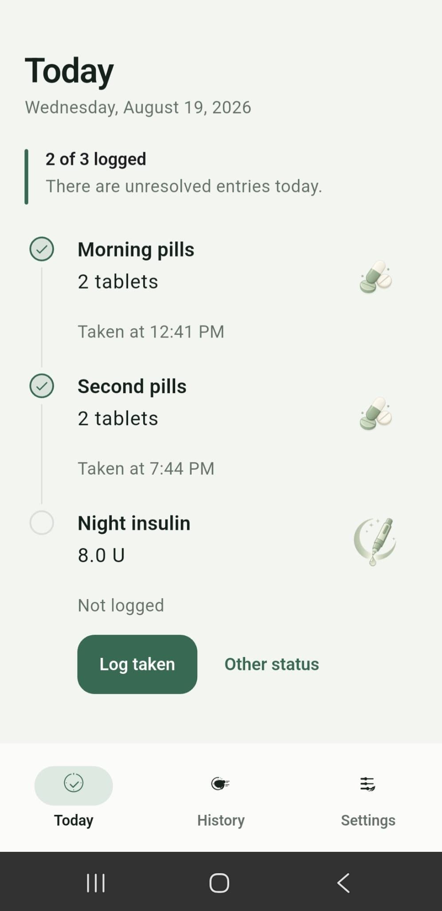
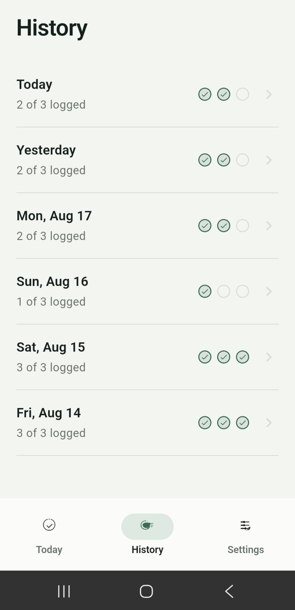
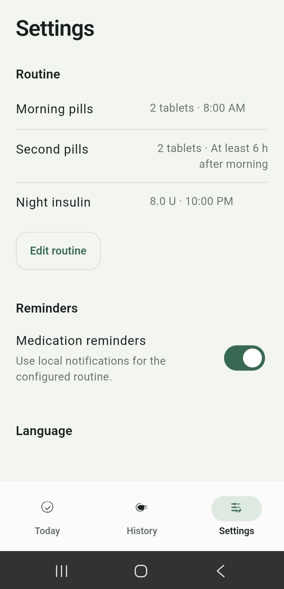
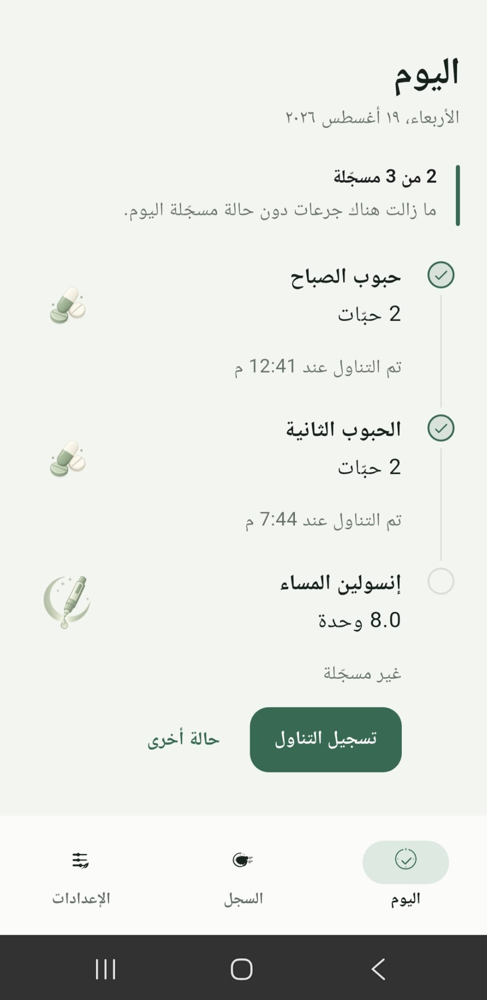

# DoseCheck

**Local medication logging and reminders, built with Flutter.**

DoseCheck records daily medication actions and keeps corrections traceable. It is designed around three views—Today, History, and Settings—and stores records on the device rather than in a user account or hosted service.



## Features

- **Daily log:** record a routine entry as taken, missed, or uncertain, with safeguards against accidental duplicate entries.
- **History:** review earlier days, see the amount originally recorded, and correct entries without silently deleting the original event.
- **Reminder scheduling:** recurring morning and evening notifications, plus a conditional second reminder after a confirmed morning entry.
- **Routine settings:** configure quantities, times, reminder preferences, and a minimum interval for the second entry.
- **Localization:** English, French, and Arabic, including right-to-left layouts.

| History | Settings | Arabic |
| --- | --- | --- |
|  |  |  |

## Platform support

Dose logging and local storage are implemented in Flutter. Medication notifications are supported on Android and iOS; Web and desktop builds do **not** schedule medication notifications.

The current application has no accounts, backend requests, cloud synchronization, or analytics SDK. Local records are specific to the device installation; they are not automatically backed up or synchronized.

## Implementation

The application uses Hive CE for local persistence and a `ChangeNotifier` controller for state coordination. Medication actions are stored as timestamped events. The effective daily status is derived from those events rather than maintained as a separate mutable table.

Changes are persisted before the UI reports success. Reminder scheduling rules are evaluated separately from the device notification plugin, which makes them testable without a phone.

See [Architecture](docs/architecture.md) for the event model, persistence, time handling, and reminder behavior.

## Getting started

Install Flutter with a compatible Dart SDK, then run:

```sh
flutter pub get
flutter gen-l10n
flutter analyze
flutter test
flutter run
```

To run the browser interface:

```sh
flutter run -d chrome
```

Browser builds are suitable for viewing and testing the logging UI, but do not schedule medication reminders. The CI workflow is configured to use Flutter **3.44.9** and to check analysis, tests, Android debug compilation, and Web release compilation.

## Safety and limitations

**DoseCheck is a personal record and reminder tool, not a medical decision system.** It does not recommend medication, calculate insulin doses, or verify whether a medication was taken. Notification delivery can be delayed or unavailable depending on device settings.

The initial routine values are **configuration examples, not prescribed doses or times**. Review them against the current treatment instructions before relying on reminders. If a dose is uncertain, the app records that uncertainty; it does not advise taking another dose.

Read [Safety and privacy](docs/safety-and-privacy.md) before using it for a real routine.

## Documentation

- [Architecture](docs/architecture.md) — implementation and data model
- [Safety and privacy](docs/safety-and-privacy.md) — usage boundaries and local data
- [Testing](docs/testing.md) — test coverage and commands
- [Product notes](docs/blueprint.md) — detailed original design rationale

## License

Copyright © 2026 Anes. All rights reserved. Public source visibility does not grant reuse or redistribution rights. See [LICENSE](LICENSE).
